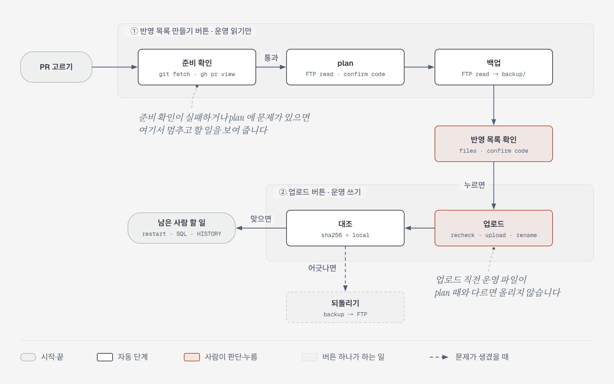

# 운영 반영 — Orca 플러그인 (`prod-deploy`)

병합된 PR 에서 바뀐 파일을 운영 서버에 **FTP 로 올리는** Orca 오른쪽 사이드바 패널입니다. IntelliJ 의 FTP Deployment 처럼 대상(서버)마다 경로 매핑을 두고, PR 하나(또는 커밋·구간 하나)를 단위로 반영합니다.



압축 푼 WAR 에 바뀐 파일만 올리는 Java 웹 애플리케이션 운영을 기준으로 만들었습니다. **이 도구는 파일만 다룹니다.** SQL 마이그레이션, 톰캣 재기동, 메뉴 등록, 재로그인 확인은 사람이 합니다.

| 문서 | 내용 |
|---|---|
| 이 README | 설치부터 첫 반영까지, 되돌리기, 안전장치, 문제 해결 |
| [docs/target-config.md](docs/target-config.md) | 대상 설정 항목, 경로 매핑, Java 빌드 출력, 손 처리 규칙 |
| [docs/cli-and-skill.md](docs/cli-and-skill.md) | CLI, Claude Code 스킬 |
| [docs/development.md](docs/development.md) | 구조, 시험, 데이터 위치 |
| [GLOSSARY.md](GLOSSARY.md) | 용어 |
| [docs/adr/](docs/adr/) | 구조를 정한 이유 |

---

## 목차

1. [요구 사항](#1-요구-사항)
2. [설치](#2-설치)
3. [대상 만들기](#3-대상-만들기)
4. [반영하기](#4-반영하기)
5. [되돌리기](#5-되돌리기)
6. [run 기록](#6-run-기록)
7. [안전장치](#7-안전장치)
8. [제한과 주의](#8-제한과-주의)
9. [문제 해결](#9-문제-해결)

---

## 1. 요구 사항

| 항목 | 내용 |
|---|---|
| OS | **Windows 10/11**. 접속 정보를 Windows 자격 증명 관리자에 두기 때문에 Windows 전용입니다. |
| Orca | 1.4.248 이상 |
| Node.js | **24 권장**(22.18 이상). `node` 가 PATH 에 있어야 합니다(TypeScript 를 빌드 없이 실행). |
| git | PATH 에 있어야 합니다. |
| curl | Windows 기본 `curl.exe` 로 충분합니다. |
| GitHub CLI (`gh`) | 병합된 PR 목록과 PR 조회에 씁니다. `gh auth login` 으로 로그인돼 있어야 합니다. |

```powershell
node --version    # v24.x
git --version
curl --version
gh auth status
```

## 2. 설치

### A. 저장소를 받아 개발 폴더로 불러오기 (확실한 방법)

```powershell
git clone https://github.com/srp-david/orca-deployment-plugin.git C:\work\tools\orca-deployment-plugin
cd C:\work\tools\orca-deployment-plugin
orca plugin dev load .
```

처음에는 허용할 권한과 **fingerprint** 를 보여 주며 승인을 요구합니다. 내용을 확인하고 직접 승인합니다.

```powershell
orca plugin dev load . --approve <출력된 fingerprint>
```

이 플러그인이 받는 권한:

- 별도 Node 프로세스로 자기 코드 실행(사용자 계정 권한 — git·curl·gh·PowerShell 을 실행)
- 플러그인 자체 저장소 사용
- 지금 작업공간의 이름·브랜치 읽기(대상 자동 선택용)
- 데스크톱 알림
- 작업공간 열기와 Orca 기본 명령 실행(상태 표시줄에서 오른쪽 사이드바 닫기용)

승인하면 오른쪽 사이드바에 로켓 아이콘 **운영 반영** 패널이 생기고, 아래 상태 표시줄에 **운영 반영** 이 나옵니다.

**업데이트**: `git pull` 하면 Orca 가 자동으로 다시 불러옵니다. 권한이 바뀐 업데이트라면 다시 승인하라고 나옵니다(`orca plugin dev reload . --approve <fingerprint>`).

### B. Orca 에서 Git URL 로 설치

Orca 의 플러그인 설치에서 Git URL 을 넣으면 플러그인 이름이 `srp-david.prod-deploy` 로 설치됩니다. 같은 권한 승인 화면이 나옵니다. (아직 이 방법으로 시험하지 않았습니다. 안 되면 A 를 쓰세요.)

## 3. 대상 만들기

**대상**은 반영할 곳 하나입니다: 저장소 하나 + FTP 주소 + 운영 루트. 대상 설정은 각자 PC 의 `~/.prod-deploy/targets/<대상 이름>.json` 에 저장되고 저장소에는 올라가지 않습니다.

1. **대상 설정** 탭 → **새 대상** → 칸을 채우고 **설정 저장**. 항목 설명은 [docs/target-config.md](docs/target-config.md).
   팀에서 쓰는 대상이면 이미 쓰고 있는 사람의 설정 파일(`~/.prod-deploy/targets/<대상>.json`)을 사내 채널로 받아 같은 위치에 두고, **메인 체크아웃**·**run 기록 폴더** 경로만 자기 PC 에 맞게 고치면 됩니다. 이 파일에는 비밀번호가 없습니다.
2. **접속 정보**: 대상 설정 탭 → 대상 고르기 → **접속 정보** 카드에 FTP 사용자·비밀번호 → **접속 정보 저장**. Windows 자격 증명 관리자에 `prod-deploy:<대상>` 으로 저장되고, 저장소·설정 파일·로그에는 남지 않습니다.
3. **설정 확인**: **확인용 커밋**(이미 운영에 반영된 것이 확실한 커밋)을 넣고 저장한 뒤 맨 아래 **설정 확인**. 그 커밋으로 plan 을 돌려(운영 읽기만) 파일이 "이미 반영됨"으로 나오면 접속·매핑·운영 루트가 맞는 것입니다. 상태 표시줄과 알림에 **설정 맞음 / 설정 확인 필요 / 설정 확인 실패** 로 나옵니다.

## 4. 반영하기

**반영 전 준비(사람이 함)**: PR 을 main 에 병합 → **메인 체크아웃을 main 으로 바꾸고 pull** → Java 가 바뀌었으면 메인 체크아웃에서 빌드. 빠졌으면 준비 확인이 알려 줍니다.

상태 표시줄의 **운영 반영** 을 누르면 패널이 열리고, 패널이 보일 때 다시 누르면 오른쪽 사이드바가 닫힙니다.

### 4-1. 대상

패널은 지금 Orca 작업공간의 저장소로 대상을 고릅니다. 못 고르면 마지막에 고른 대상, 그것도 없으면 직접 고르게 합니다(시험용 대상은 자동으로 고르지 않습니다). FTP 주소·운영 루트·메인 체크아웃이 늘 보이고, 작업공간 저장소와 대상 저장소가 다르면 경고합니다.

### 4-2. PR 고르기 → 반영 목록 만들기

**반영할 PR** 카드에 대상 저장소 main 에 최근 병합된 PR 이 나옵니다. 이 패널로 이미 올린 PR 은 **반영됨**, 목록까지 만든 PR 은 **목록 만듦** 으로 표시합니다.

- PR 을 누르면 **고르기만** 합니다(아래 칸에 `#번호`). 커밋 해시나 `기준..끝` 구간은 그 칸에 직접 넣습니다.
- **반영 목록 만들기** 를 누르면 아래를 차례로 합니다. 운영은 읽기만 합니다.
- **초기화** 는 고른 PR·준비 확인·열린 반영 목록·상태 표시줄을 처음으로 되돌립니다(만든 run 은 run 기록에 남음).

**① 준비 확인** — 하나라도 실패하면 멈추고 할 일 명령을 보여 줍니다. 고친 뒤 **다시 확인**.

| 확인 | 실패하면 |
|---|---|
| PR 이 병합됐는가 / 커밋이 main 에 있는가 | 병합부터 |
| 메인 체크아웃이 main 브랜치인가 | `git switch main` |
| main pull 이 됐는가(반영 커밋 포함, origin/main 보다 뒤처지지 않음) | `git pull --ff-only` |
| 바뀐 파일에 커밋 안 한 수정이 없는가 | 수정 정리 |
| 바뀐 Java 의 class 가 main 소스로 빌드됐는가(있음·소스보다 새것·버전) | 빌드 명령 |

**② plan** — 바뀐 파일을 운영 경로로 바꾸고, 운영의 지금 파일을 받아 반영 커밋·직전 커밋과 대조합니다. 반영 목록 카드에 나오는 것:

- **반영 목록**: 파일마다 덮어씀/새 파일, 로컬 경로 → 운영 경로
- 손 처리 파일, 매핑 밖 파일, 참고(빌드 폴더의 옛 내부 클래스는 올리지 않음, 상수 값 변경 등)
- PR 본문의 "반영 시 주의" 절, class 가 있으면 "톰캣 재기동 필요"
- **문제**: 하나라도 있으면 그 run 은 올리지 못합니다. 고친 뒤 다시 만듭니다.
  - 운영본이 이미 반영 커밋과 같음(이미 반영됨?)
  - 운영본이 직전 커밋과 다름(운영에만 있는 수정?)
  - 저장소엔 새 파일인데 운영에 이미 있음
  - main 에 이후 변경 있음(HEAD 파일 ≠ 반영 커밋)
  - 운영 폴더 목록을 확인할 수 없음(권한·시간 초과)
  - `src/main` 아래인데 경로 매핑·손 처리 규칙이 없음(조용히 빠지지 않게)
- **경고**: 업로드를 막지 않습니다. 올리기 전에 보고 판단하세요.
  - class 의 상수 값이 바뀌었는데, 그 상수 이름이 나오는 다른 소스가 반영 목록에 없음. Java 는 상수 값을 쓰는 class 에 복사해 두므로, 그 소스가 정말 이 상수를 쓰면 그 class 도 올려야 합니다. 이름만 같은 다른 변수면 그대로 올려도 됩니다.
- **확인 코드**: 이 대상과 반영 목록을 가리키는 8자리 코드

**③ 백업** — 문제가 없으면 덮어쓸 운영 파일을 run 폴더에 받고 plan 때와 같은지 확인합니다. 백업이 실패하면 반영 목록 카드에 **백업** 버튼이 나옵니다.

### 4-3. 업로드

반영 목록을 확인하고 **`<대상 이름>에 N개 업로드`** 를 누릅니다. **이 버튼을 누르는 것이 최종 확인입니다.**

1. 업로드 직전에 브랜치·HEAD·로컬 파일·운영 파일을 다시 확인하고, 승인한 바이트를 고정본으로 떠서 그것만 올립니다(파일마다 임시 이름으로 올린 뒤 이름 바꾸기, 다시 받아 대조).
2. 다 올리면 이어서 운영 파일이 올린 파일과 같은지(sha256) 대조합니다. 맞지 않으면 **다시 대조** 버튼과 되돌리기가 나옵니다.

끝나면 남은 사람 할 일(톰캣 재기동, PR 의 SQL·등록 순서, 손 처리 파일, 재로그인 확인, 반영 이력 기록)을 보여 줍니다. 진행은 상태 표시줄과 알림으로도 알려 주고, 패널을 닫아도 업로드는 끝까지 갑니다.

## 5. 되돌리기

반영 목록 카드의 **되돌리기**: 덮어쓴 파일은 백업으로 되올리고, 새로 만든 파일은 지웁니다.

- 업로드가 중간에 멈춘 run(**부분 업로드**)은 이어 올리지 않습니다. 되돌린 뒤 새로 만듭니다.
- 이 run 보다 **나중에 올린 run 이 같은 운영 파일**을 건드렸으면 막습니다(그 run 을 먼저 되돌리세요).
- 올린 뒤 **운영 파일이 누군가에 의해 바뀌었으면** 막습니다(손으로 확인).
- 되돌린 run 은 다시 올리지 않습니다.

## 6. run 기록

**run 기록** 탭에 이 대상의 run 이 최근 것부터 나옵니다. 한 번 누르면 로그, 두 번 누르면 반영 탭에서 그 run 의 반영 목록이 열립니다.

**목록 비우기** 는 run 을 지우지 않고 화면에서만 숨깁니다. 업로드한 run 의 백업과 기록은 되돌리기와 "같은 파일을 건드린 나중 반영" 확인에 쓰이므로 지우지 않습니다. 부분 업로드 run 은 되돌려야 하는 상태라 숨기지 않습니다. **숨긴 run 보기** 로 다시 보고 **모두 다시 보이기** 로 되돌립니다.

## 7. 안전장치

- 대상을 바꾸거나 대상 설정을 저장하면 준비 확인·반영 목록·확인 코드를 버립니다.
- run 에는 그때의 대상 설정 사본이 남고, 지금 설정과 다르면 그 run 은 백업·업로드할 수 없습니다(되돌리기는 run 에 적힌 주소로).
- 확인 코드가 승인한 plan 과 다르면 올리지 않습니다.
- 백업 전에는 올리지 않고, 백업이 plan 때 운영본과 다르면 올리지도 되돌리지도 않습니다.
- 대상마다 잠금: 백업·업로드·대조·되돌리기는 한 번에 하나만. 끝난 작업이 잠금을 남겼으면 자동으로 치우지 않고 사람이 **잠금 풀기** 로 풉니다.
- FTP 목록을 확실히 받지 못하면 "파일 없음"으로 보지 않고 멈춥니다.
- 접속 정보는 stdin 으로만 curl·PowerShell 에 넘깁니다(명령줄·로그에 남지 않음).

## 8. 제한과 주의

- **여러 PC 에서 같은 대상에 동시에 반영하는 경우를 막지 못합니다.** 잠금과 run 기록이 PC 마다 따로입니다. 업로드 직전·되돌리기 전에 운영 파일을 다시 대조하므로 덮어쓰기는 대부분 잡히지만, **반영 전에 팀에 알리세요.**
- 다른 PC 나 다른 도구(IntelliJ 등)로 반영한 것은 이 패널의 run 기록에 없습니다. 그 파일을 되돌릴 때 "나중 반영" 확인에 잡히지 않으니, 운영 파일 재대조에 기대거나 손으로 확인하세요.
- FTP 만 지원합니다(FTPS·SFTP 없음).
- 삭제된 파일은 운영에서 자동으로 지우지 않습니다(손 처리 파일로 보여 줌).
- class 파일은 운영본과의 대조(이미 반영됨·운영에만 있는 수정)를 하지 않습니다. 상수 값만 비교해서, 바뀐 상수의 이름이 나오는 소스가 반영 목록에 없으면 **경고**를 띄웁니다. 경고는 낱말 검색이라 이름만 같은 다른 변수도 잡히고, 업로드를 막지 않습니다([ADR 0005](docs/adr/0005-constant-changes-warn-not-block.md)).
- `src/main/` 아래 파일은 경로 매핑이나 손 처리 규칙에 걸려야 합니다. 어디에도 없으면 문제로 막습니다(빠진 채 올라가지 않게).
- 메인 체크아웃의 빌드·pull 은 패널이 하지 않습니다.

## 9. 문제 해결

| 증상 | 할 일 |
|---|---|
| 패널에 "대상이 없음" | 대상 설정 탭에서 대상을 만들거나 **다시 불러오기**(↻) |
| "워커에 연결하지 못함" | `orca plugin logs <플러그인 이름>` 으로 오류 확인(`orca plugin list` 로 이름 확인) |
| "PR 목록을 받지 못함" / PR 을 찾지 못함 | `gh auth status`, 메인 체크아웃의 origin 이 그 GitHub 저장소인지 |
| "끝난 작업의 잠금이 남아 있음" | 그 작업이 정말 끝났는지(다른 창·터미널) 본 뒤 **잠금 풀기** |
| "접속 정보 없음" | [3. 대상 만들기](#3-대상-만들기)의 2번대로 접속 정보 저장 |
| "운영 폴더 목록을 확인할 수 없음" | FTP 계정의 목록 권한·네트워크 확인. 있는지 없는지 모르면 진행하지 않습니다. |
| "대상 설정이 이 run 을 만든 뒤 바뀜" | 반영 목록을 새로 만들기 |
| "운영에 들어가는 폴더(src/main)인데 경로 매핑·손 처리 규칙이 없음" | 올릴 파일이면 대상 설정에 경로 매핑을 추가, 올리지 않을 파일이면 손 처리 규칙에 추가([대상 설정](docs/target-config.md)). 그 뒤 반영 목록을 새로 만들기 |
| "빌드 폴더의 class 를 읽지 못했거나 소스 파일 이름(SourceFile)이 없음" | 빌드 결과 폴더를 지우고 다시 빌드(예: `gradlew clean classes`). 디버그 정보를 끈 빌드(`-g:none`)는 지원하지 않음 |
| "class 없음" / "class 가 소스보다 오래됨" | 메인 체크아웃에서 빌드(대상 설정의 빌드 명령) |
| 반영 목록 카드에 "경고" | 적힌 소스를 열어 그 상수를 정말 쓰는지 확인. 쓰면 그 class 도 함께 올려야 함. 이름만 같으면 그대로 업로드 |
| 상태 표시줄을 눌러도 패널이 안 열림 | `orca plugin logs` 의 "패널 열기 실패" 줄 확인(Orca CLI `orca.exe` 를 못 찾는 경우 등) |
| "input: Invalid input" 같은 Orca 오류 | 플러그인을 최신으로(`git pull`) — 패널↔워커 값 형식 문제로 고친 적이 있음 |
