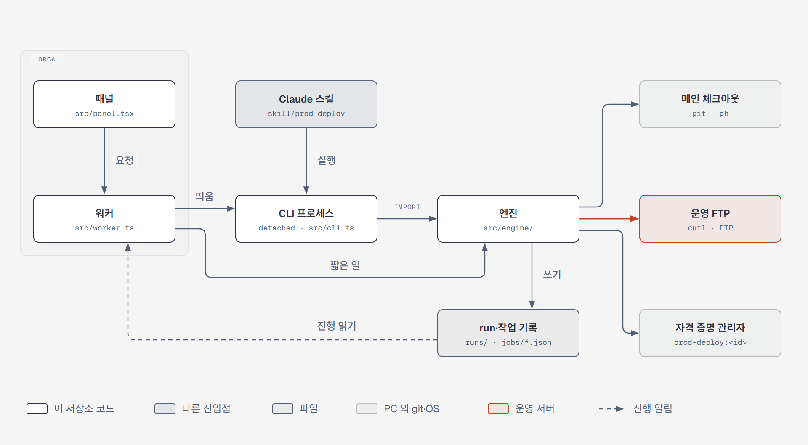

# 개발

## 구조



```
src/engine/          엔진(TS, 빌드 단계 없음) — 대상 설정, git, FTP(curl), 자격 증명, plan·백업·업로드·대조·되돌리기, run 기록, 작업 기록
src/cli.ts           CLI. 스킬과 워커가 같은 엔진을 이 명령으로 부름
src/worker.ts        플러그인 워커. 짧은 일은 엔진을 직접, 운영 FTP 단계는 CLI 프로세스를 따로 띄움(ADR 0002)
src/panel.tsx        패널(Orca components)
src/protocol.ts      패널↔워커 요청·이벤트 약속
src/config-verdict.ts  "설정 확인" 판정(패널·워커가 같이 씀, Node API 없음)
src/open-panel.ts    상태 표시줄 → 패널 열기(Orca CLI `orca plugin open`)
skill/               Claude Code 스킬과 확인 훅, 설치 스크립트
examples/            대상 설정 예시
test/                엔진 단위·안전 시험, 훅 시험, e2e, 시험 FTP 서버
```

TypeScript 는 빌드하지 않습니다. Node 24 의 타입 제거로 바로 실행하고, Orca 도 `.ts` 를 그대로 불러옵니다. 플러그인 타입은 `orca plugin types .` 로 `.orca/types/` 에 받습니다(저장소에는 올리지 않음).

## 시험

```powershell
node --test test/*.spec.ts   # 엔진 단위·안전 회귀·스킬 훅·패널 열기·설정 확인 판정
orca plugin test .           # 패널·워커(mock host)
orca plugin check .          # 패널을 워커와 함께 한 번 그리기
node test/e2e.ts             # 임시 저장소 + 시험 FTP 로 CLI 전체 흐름
```

e2e 와 시험용 대상에는 시험 FTP 서버(pyftpdlib)가 필요합니다.

```powershell
python -m venv $HOME\.prod-deploy\test-ftp\venv
& $HOME\.prod-deploy\test-ftp\venv\Scripts\python.exe -m pip install pyftpdlib
```

패널에서 시험용 대상으로 흐름을 돌려 볼 때:

```powershell
git clone <시험할 저장소> $HOME\.prod-deploy\test-repo
copy examples\local-test.json $HOME\.prod-deploy\targets\test.json
"test`ntest" | node src/cli.ts creds test set
node test/seed-test-ftp.ts <커밋>     # 시험 FTP 루트를 그 커밋의 직전 상태로 채움
& $HOME\.prod-deploy\test-ftp\venv\Scripts\python.exe -I test/ftp-server.py $HOME\.prod-deploy\test-ftp\root 2121
```

패널 화면은 `orca plugin shot <플러그인 이름> --panel deploy` 로 찍습니다. `--act`(버튼 누르기)는 Orca 창이 숨겨져 있어야 하고, 1.4.253 에서는 동작이 성공으로 나와도 화면에 반영되지 않는 경우가 있었습니다. 그때는 사람이 화면을 띄워 두고 `--act` 없이 찍습니다.

## 패널↔워커 주의

- 패널이 보내는 요청과 워커의 응답에 **`undefined` 칸이 있으면 Orca 가 거절**합니다("input: Invalid input", "answered with a non-JSON value"). 워커 응답은 `guard()` 에서, 패널 요청은 `plain()` 으로 JSON 으로 한 번 바꿔 보냅니다. host 호출(`notifications.show` 등)도 빈 칸을 빼고 보냅니다.
- 워커는 요청 하나에 최대 120초, 할 일이 없으면 5분 뒤 정리되고, dev 폴더가 바뀌면 다시 시작됩니다. 오래 걸리는 일은 CLI 프로세스로 띄우고 `~/.prod-deploy/jobs/<id>.json` 으로 진행을 주고받습니다. CLI 는 10초마다 `beat` 를 남기고, 2분 넘게 멈추면 끝난 작업으로 봅니다(프로세스 번호는 재사용될 수 있음).

## 데이터 위치

| 무엇 | 어디 |
|---|---|
| 대상 설정 | `~/.prod-deploy/targets/<대상>.json` (이전 설정 `.history/`, 지운 설정 `.deleted/`) |
| 접속 정보 | Windows 자격 증명 관리자 `prod-deploy:<대상>` |
| run 기록 | 대상 설정의 `runs` 폴더, `<대상>-<YYYYMMDD-HHMMSS>-<커밋 8자리>/` |
| run 위치 색인 | `~/.prod-deploy/run-index/` (run 기록 폴더를 바꿔도 예전 run 을 찾음) |
| 잠금·작업 진행 | `~/.prod-deploy/locks/`, `~/.prod-deploy/jobs/` |

run 폴더: `meta.env`(대상·기준·반영 커밋·HEAD), `plan.tsv`(반영 목록), `errors.txt`(문제), `manual.tsv`·`skip.tsv`·`notes.tsv`, `target.json`(그때의 설정), `pr.json`, `backup/`, `stage/`(업로드할 바이트 고정본), `deploy.log`, 단계별 표시(`plan.done`, `backup.done`, `upload.started`, `upload.done`, `verify.done`·`verify.failed`, `rollback.done`), `hidden`(run 기록 화면에서 숨김).

확인 코드 = `sha256(대상 이름 + "\n" + plan.tsv)` 의 앞 8자리. run 폴더 형식과 확인 코드는 예전 bash 도구와 같아서, 그때 만든 run 도 읽고 되돌릴 수 있습니다(ADR 0001).

## 그림

`docs/diagrams/*.html` 이 원본(SVG 를 담은 HTML)이고, 문서에는 같은 폴더의 PNG 를 넣습니다. 그림을 고친 뒤 diagram-design 플러그인의 `scripts/export_png.py <html> <png> 2` 로 PNG 를 다시 만듭니다.
